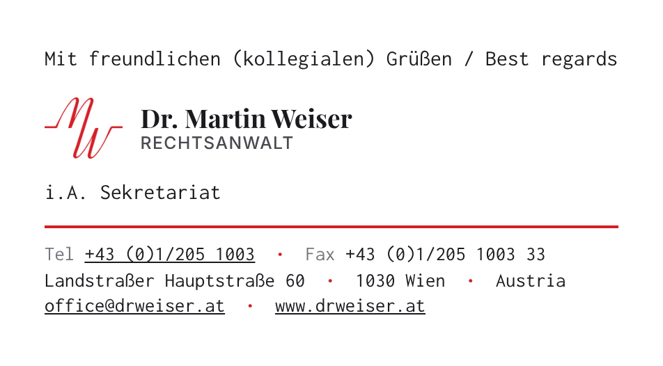

# E-Mail-Signatur – Kanzlei Dr. Martin Weiser

Neue E-Mail-Signatur in zwei Entwürfen. Die Schrift bleibt **Consolas** wie bisher.
Logo und Schriftzug sehen aus wie auf www.drweiser.at, nur ohne den Hintergrund.

**Entwurf A – kurzer roter Strich**

**Entwurf B – langer roter Strich**

## Was ist neu

- In der ersten Zeile steht „Mit freundlichen (kollegialen) Grüßen / Best regards“.
- Das rote „MW“-Logo mit dem Schriftzug „Dr. Martin Weiser / Rechtsanwalt“ ist genau wie auf der Website.
  Verwendet werden das Original-Logo und die Website-Schriften (Playfair Display, Inter).
- Telefonnummer, E-Mail-Adresse und Website sind verlinkt und unterstrichen.
  Am Handy ruft ein Antippen der Nummer direkt an. Auch das Logo führt zur Website.
- Die Telefonnummern stehen so wie auf der Website da: +43 (0)1/205 1003
- Die Signatur ist linksbündig, klarer gegliedert und hat Akzente im Kanzlei-Rot.
- Im Dunkelmodus steht das Logo auf einer weißen Fläche und bleibt so gut lesbar.
  Am Handy brechen die Zeilen sauber um.

## Dateien

| Datei | Wofür |
| --- | --- |
| `signatur.html` | Entwurf A für Outlook am PC (klassisches Outlook) |
| `signatur-web.html` | Entwurf A mit eingebautem Logo, für das neue Outlook, Outlook im Web und den Mac |
| `signatur-langer-strich.html` | Entwurf B für Outlook am PC (klassisches Outlook) |
| `signatur-langer-strich-web.html` | Entwurf B mit eingebautem Logo, für das neue Outlook, Outlook im Web und den Mac |
| `logo-signatur.png` | Logo mit Schriftzug, muss im selben Ordner liegen wie die HTML-Dateien |
| `vorschau.png`, `vorschau-langer-strich.png` | Vorschau der beiden Entwürfe |

## In Outlook einrichten (Windows, klassisches Outlook)

1. Den Ordner `email-signatur` auf den PC laden, z. B. in „Downloads“.
   Die HTML-Dateien und `logo-signatur.png` müssen zusammen im selben Ordner bleiben.
2. Den gewünschten Entwurf doppelklicken: `signatur.html` (A) oder `signatur-langer-strich.html` (B).
   Die Signatur öffnet sich im Browser.
3. **Strg + A** drücken, dann **Strg + C**.
4. In Outlook auf **Datei → Optionen → E-Mail → Signaturen… → Neu** gehen und einen Namen eingeben, z. B. „Kanzlei“.
5. In das große Bearbeitungsfeld klicken, **Strg + V** drücken und dann auf **Speichern** klicken.
6. Rechts oben bei „Neue Nachrichten“ und „Antworten/Weiterleitungen“ die neue Signatur auswählen und mit **OK** bestätigen.

## Neues Outlook oder Outlook im Web

Die Schritte sind dieselben wie oben, nur mit der Datei, die auf `-web.html` endet.
Eingefügt wird unter **Einstellungen (Zahnrad) → Konten → Signaturen**.

## Mac (Apple Mail oder Outlook für Mac)

1. Die Datei, die auf `-web.html` endet, in Safari öffnen.
2. **Cmd + A** drücken, dann **Cmd + C**.
3. Die Signatur im Signatur-Fenster einfügen:
   - Apple Mail: **Mail → Einstellungen → Signaturen**
   - Outlook für Mac: **Outlook → Einstellungen → Signaturen**
4. In Apple Mail unter dem Signaturfeld das Häkchen bei der Standardschrift entfernen.
   Sonst ersetzt Mail die Schrift Consolas.

## Gut zu wissen

- Die Website-Links führen auf https://drweiser.at ohne „www“, angezeigt wird aber „www.drweiser.at“.
  Das Sicherheitszertifikat der Website gilt nämlich nur für drweiser.at.
  Ein Link auf https://www.drweiser.at würde eine Sicherheitswarnung zeigen.
- Die Vorschau entstand mit einer Ersatzschrift, die Consolas sehr ähnlich ist.
  In Outlook erscheint die echte Consolas.
- Empfänger ohne Consolas, z. B. am iPhone, sehen automatisch eine ähnliche Schrift.
