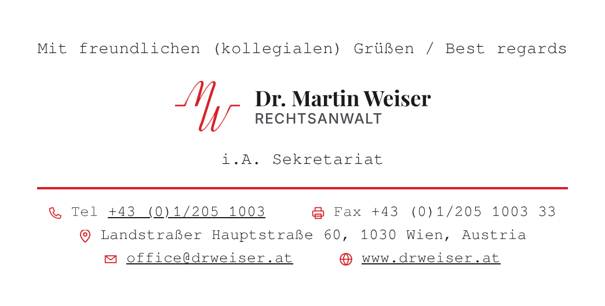
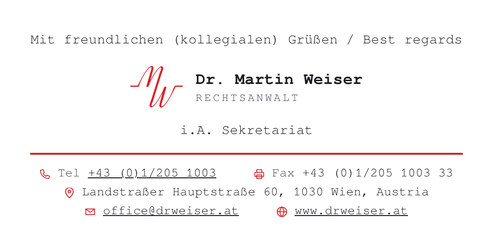

# E-Mail-Signatur – Kanzlei Dr. Martin Weiser

Zentriert, in **Courier New**, mit langem rotem Strich und den Kontakt-Symbolen der Website.
Es gibt zwei Fassungen zur Auswahl.

**A – Logo wie auf der Website** (Name in den Website-Schriften, als Bild)

**B – alles in Courier New** (rotes MW-Zeichen, Name als Text in Courier New)

Bei Fassung B ist der Name echter Text und kein Bild.
Er erscheint daher immer, auch wenn ein Mailprogramm Bilder blockiert, und passt sich im Dunkelmodus an.

## Dateien

| Datei | Wofür |
| --- | --- |
| `Signatur-A-Logo-wie-Website.zip` | Fassung A zum Herunterladen |
| `Signatur-B-alles-Courier-New.zip` | Fassung B zum Herunterladen |
| `A-logo-wie-website/`, `B-alles-courier-new/` | Inhalt der beiden ZIP-Dateien |

Jede ZIP-Datei enthält:

| Datei | Wofür |
| --- | --- |
| `Kanzlei.htm` | die Signatur für Outlook, braucht den Ordner `bilder` daneben |
| `bilder/` | Logo bzw. MW-Zeichen und Symbole |
| `Kanzlei.txt` | Textfassung für E-Mails im Nur-Text-Format (nur für Plan B nötig) |
| `signatur-komplett.html` | dieselbe Signatur mit eingebauten Bildern, zum Ansehen und für den Mac |

## Einrichten im klassischen Outlook (oben links gibt es „Datei“)

Die Schritte sind für beide Fassungen gleich.
Kopiert wird über Word, weil Outlook aus dem Browser keine Bilder mitnimmt.

1. Die ZIP-Datei der gewünschten Fassung herunterladen.
   Dann mit Rechtsklick → **Alle extrahieren…** → **Extrahieren** entpacken.
2. Im entpackten Ordner mit Rechtsklick auf `Kanzlei.htm` → **Öffnen mit** → **Word** gehen.
   Steht Word nicht in der Liste: **Andere App auswählen** → **Word**.
3. Erscheint oben ein gelber Balken „Geschützte Ansicht“, auf **Bearbeitung aktivieren** klicken.
   Jetzt sollten Logo und Symbole zu sehen sein.
4. **Strg + A** und dann **Strg + C** drücken. Danach Word schließen, ohne zu speichern.
5. In Outlook auf **Datei → Optionen → E-Mail → Signaturen…** gehen.
   Die alte Signatur „Kanzlei“ auswählen und **Löschen**.
   Dann auf **Neu** klicken, „Kanzlei“ eingeben und mit **OK** bestätigen.
6. Ins Feld „Signatur bearbeiten“ klicken, **Strg + V** drücken und auf **Speichern** klicken.
7. Rechts bei **Neue Nachrichten** und **Antworten/Weiterleitungen** jeweils „Kanzlei“ auswählen und mit **OK** bestätigen.
8. Eine Testmail an die eigene Adresse und ans Handy schicken.

## Plan B: Dateien direkt in den Signaturen-Ordner legen

Nur nötig, falls die Bilder auch über Word nicht mitkommen.

1. Outlook schließen.
2. **Windows-Taste + R** drücken, `%APPDATA%\Microsoft\Signatures` eingeben und **OK** klicken.
3. Aus dem entpackten Ordner `Kanzlei.htm`, `Kanzlei.txt` und den Ordner `bilder` hineinkopieren.
   Fragt Windows nach dem Ersetzen, **Ersetzen** wählen.
4. Outlook starten und unter **Datei → Optionen → E-Mail → Signaturen…** „Kanzlei“ als Standard auswählen.

## Neues Outlook (kein „Datei“-Menü)

Den Weg über Word bietet das neue Outlook nicht. Bitte kurz Bescheid geben, dann gibt es eine passende Anleitung.

## Mac (Apple Mail oder Outlook für Mac)

1. `signatur-komplett.html` in Safari öffnen.
2. **Cmd + A** und dann **Cmd + C** drücken.
3. Die Signatur im Signatur-Fenster einfügen:
   - Apple Mail: **Mail → Einstellungen → Signaturen**
   - Outlook für Mac: **Outlook → Einstellungen → Signaturen**
4. In Apple Mail unter dem Signaturfeld das Häkchen bei der Standardschrift entfernen.

## Gut zu wissen

- Die Symbole sind die der Website (Telefon, Adresse, E-Mail).
  Für Fax und Website gibt es dort keine eigenen Symbole, deshalb sind Drucker und Globus im selben Stil ergänzt.
- Telefonnummer, E-Mail-Adresse und Website sind verlinkt.
- Die Website-Links führen auf https://drweiser.at ohne „www“, angezeigt wird aber „www.drweiser.at“.
  Das Sicherheitszertifikat der Website gilt nämlich nur für drweiser.at.
- Die Vorschauen entstanden mit einer Ersatzschrift, die Courier New sehr ähnlich ist.
  In Outlook erscheint die echte Courier New.
