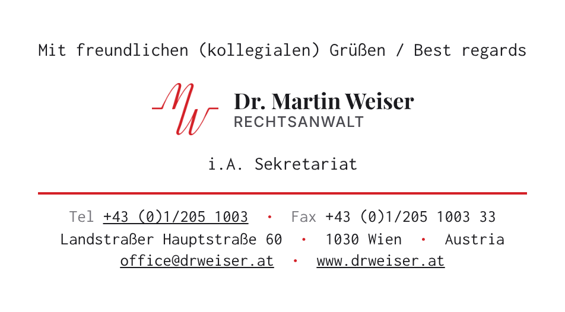

# E-Mail-Signatur – Kanzlei Dr. Martin Weiser

Neue E-Mail-Signatur mit langem rotem Strich, in zwei Fassungen: linksbündig und zentriert (wie die alte).
Die Schrift bleibt **Consolas** wie bisher.
Logo und Schriftzug sehen aus wie auf www.drweiser.at, nur ohne den Hintergrund.

**Linksbündig**

**Zentriert**

## Dateien

| Fassung | Klassisches Outlook (beide Dateien in denselben Ordner) | Neues Outlook, Outlook im Web, Mac |
| --- | --- | --- |
| Linksbündig | `signatur-links.html` + `logo-signatur.png` | `signatur-links-web.html` |
| Zentriert | `signatur-zentriert.html` + `logo-signatur-zentriert.png` | `signatur-zentriert-web.html` |

In den Dateien, die auf `-web.html` enden, ist das Logo schon eingebaut. Sie funktionieren also allein.

## Welches Outlook habe ich?

- **Klassisches Outlook:** Oben links gibt es den Menüpunkt **Datei**.
- **Neues Outlook:** Es gibt kein „Datei“-Menü. Oben rechts ist der Schalter **Neues Outlook** eingeschaltet.

## Dateien auf den PC holen

1. Die Dateien aus dem Chat herunterladen.
   Alternativ geht es über GitHub: im Repository den Branch `claude/determined-mccarthy-0thvsh` wählen und **Code → Download ZIP** anklicken.
2. Alles in einen eigenen Ordner legen, z. B. `Dokumente\Signatur`.
   Eine ZIP-Datei vorher entpacken (Rechtsklick → **Alle extrahieren**).
   Öffnet man die HTML-Datei direkt in der ZIP, fehlt sonst das Logo.

## Klassisches Outlook (Windows)

1. Die HTML-Datei doppelklicken, also `signatur-zentriert.html` oder `signatur-links.html`.
   Sie öffnet sich im Browser (Edge oder Chrome).
2. Ins Browserfenster klicken, dann **Strg + A** (alles markieren) und **Strg + C** (kopieren) drücken.
3. In Outlook auf **Datei → Optionen → E-Mail** gehen und die Schaltfläche **Signaturen…** anklicken.
4. Im Reiter „E-Mail-Signatur“ auf **Neu** klicken, einen Namen eingeben (z. B. „Kanzlei“) und mit **OK** bestätigen.
5. In das große Feld „Signatur bearbeiten“ klicken, **Strg + V** drücken und dann auf **Speichern** klicken.
6. Rechts unter „Standardsignatur auswählen“ das Konto office@drweiser.at wählen.
   Bei **Neue Nachrichten** und **Antworten/Weiterleitungen** jeweils „Kanzlei“ auswählen und mit **OK** bestätigen.
7. Eine neue E-Mail öffnen: Die Signatur erscheint automatisch.
   Zum Prüfen am besten eine Testmail an die eigene Adresse und ans Handy schicken.

## Neues Outlook oder Outlook im Web

1. Die Datei, die auf `-web.html` endet, im Browser öffnen.
2. **Strg + A** und dann **Strg + C** drücken.
3. In Outlook oben rechts auf das Zahnrad (**Einstellungen**) klicken und **Konten → Signaturen** öffnen.
4. Auf **Neue Signatur** klicken, einen Namen eingeben, ins Textfeld klicken und **Strg + V** drücken.
5. Darunter die Standardsignatur für neue Nachrichten und für Antworten wählen und auf **Speichern** klicken.

## Mac (Apple Mail oder Outlook für Mac)

1. Die Datei, die auf `-web.html` endet, in Safari öffnen.
2. **Cmd + A** und dann **Cmd + C** drücken.
3. Die Signatur im Signatur-Fenster einfügen:
   - Apple Mail: **Mail → Einstellungen → Signaturen**
   - Outlook für Mac: **Outlook → Einstellungen → Signaturen**
4. In Apple Mail unter dem Signaturfeld das Häkchen bei der Standardschrift entfernen.
   Sonst ersetzt Mail die Schrift Consolas.

## Wenn etwas nicht passt

- **Das Logo fehlt im klassischen Outlook:** Die HTML-Datei und das passende PNG müssen im selben, entpackten Ordner liegen.
  Klappt es trotzdem nicht, stattdessen die Datei probieren, die auf `-web.html` endet.
- **Die alte Signatur erscheint noch:** Schritt 6 kontrollieren, dort muss die neue Signatur ausgewählt sein.

## Gut zu wissen

- Telefonnummer, E-Mail-Adresse und Website sind verlinkt. Auch das Logo führt zur Website.
- Die Website-Links führen auf https://drweiser.at ohne „www“, angezeigt wird aber „www.drweiser.at“.
  Das Sicherheitszertifikat der Website gilt nämlich nur für drweiser.at.
  Ein Link auf https://www.drweiser.at würde eine Sicherheitswarnung zeigen.
- Im Dunkelmodus steht das Logo auf einer weißen Fläche und bleibt so gut lesbar.
  Am Handy brechen die Zeilen sauber um.
- Die Vorschau entstand mit einer Ersatzschrift, die Consolas sehr ähnlich ist.
  In Outlook erscheint die echte Consolas.
- Empfänger ohne Consolas, z. B. am iPhone, sehen automatisch eine ähnliche Schrift.
