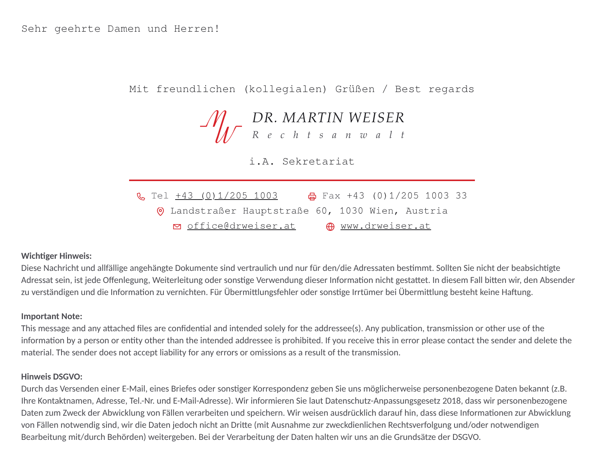

# E-Mail-Signatur – Kanzlei Dr. Martin Weiser

Endgültige Fassung: oben „Sehr geehrte Damen und Herren!“, darunter Platz für den Text und die zentrierte Signatur.
Die Signatur besteht aus dem roten MW-Zeichen, „DR. MARTIN WEISER“ in Palatino kursiv und „Rechtsanwalt“ auf dieselbe Länge gesperrt.
MW-Zeichen, Name und „Rechtsanwalt“ sind zusammen **ein Bild**, damit beim Versenden nichts verrutscht.
Grußformel, Kontaktdaten und Anrede stehen in Courier New 11 pt, die Kontaktdaten mit den Symbolen der Website.
Ganz unten folgt der Hinweistext in Calibri, klein und grau.

## Paket

**`Signatur-Kanzlei-Weiser.zip`** enthält alles. Der Ordner `Signatur-Kanzlei-Weiser/` ist der entpackte Inhalt.

| Datei | Wofür |
| --- | --- |
| `ANLEITUNG.txt` | Schritt-für-Schritt-Anleitung (Windows und Mac) |
| `Windows-Outlook/Kanzlei.htm` | Signatur mit „Sehr geehrte Damen und Herren!“ |
| `Windows-Outlook/Kanzlei ohne Anrede.htm` | dieselbe Signatur ohne Anrede, z. B. für Antworten |
| `Windows-Outlook/bilder/` | MW-Zeichen und Symbole, muss neben den `.htm`-Dateien bleiben |
| `Windows-Outlook/*.txt` | Textfassungen für E-Mails im Nur-Text-Format |
| `Mac/Kanzlei-Signatur.html` | für Apple Mail und Outlook für Mac, Bilder eingebaut |
| `Mac/Kanzlei-Signatur-ohne-Anrede.html` | dasselbe ohne Anrede |

## Einrichten im klassischen Outlook (Windows)

Auf dem **ersten Computer**:

1. Die ZIP-Datei mit Rechtsklick → **Alle extrahieren…** → **Extrahieren** entpacken.
2. Im Ordner `Windows-Outlook` mit Rechtsklick auf `Kanzlei.htm` → **Öffnen mit** → **Word** gehen.
3. Erscheint ein gelber Balken „Geschützte Ansicht“, auf **Bearbeitung aktivieren** klicken.
4. **Strg + A** und dann **Strg + C** drücken. Danach Word schließen, ohne zu speichern.
5. In Outlook auf **Datei → Optionen → E-Mail → Signaturen…** gehen.
   Die alte Signatur „Kanzlei“ **löschen**, dann auf **Neu** klicken und „Kanzlei“ eingeben.
6. Ins Feld „Signatur bearbeiten“ klicken, **Strg + V** drücken und auf **Speichern** klicken.
7. Optional die Schritte 2 bis 6 mit `Kanzlei ohne Anrede.htm` wiederholen, Name „Kanzlei ohne Anrede“.
8. Standardsignaturen festlegen:
   - Neue Nachrichten: „Kanzlei“
   - Antworten/Weiterleitungen: „Kanzlei“ oder „Kanzlei ohne Anrede“

   Mit **OK** bestätigen.
9. Eine Testmail an die eigene Adresse schicken.

Den Text in die Leerzeilen unter „Sehr geehrte Damen und Herren!“ schreiben.
Dort steht er automatisch in Courier New 11, genauso groß wie die Grußformel.

Auf den **anderen Computern**:

1. Auf dem ersten Computer in Outlook auf **Datei → Optionen → E-Mail** gehen und mit **gedrückter Strg-Taste** auf **Signaturen…** klicken.
   Der Signaturen-Ordner öffnet sich.
2. Alles, was mit „Kanzlei“ beginnt, auf einen USB-Stick kopieren, also die Dateien und den Ordner `Kanzlei-Dateien`.
3. Auf dem nächsten Computer den Ordner genauso öffnen, Outlook schließen, alles hineinkopieren und **Ersetzen** wählen.
4. Outlook starten und die Standardsignaturen wie in Schritt 8 auswählen.

Damit auch sonst alles in derselben Schrift geschrieben wird (optional):
**Datei → Optionen → E-Mail → Briefpapier und Schriftarten…**.
Dort bei „Neue E-Mail-Nachrichten“ und „Antworten oder Weiterleiten“ jeweils **Schriftart…** wählen und **Courier New, 11** einstellen.

## Mac (Apple Mail oder Outlook für Mac)

1. Die ZIP-Datei mit Doppelklick entpacken.
2. `Mac/Kanzlei-Signatur.html` in Safari öffnen.
3. **Cmd + A** und dann **Cmd + C** drücken.
4. Die Signatur einfügen:
   - Apple Mail: **Mail → Einstellungen → Signaturen → +**, einfügen und das Häkchen bei der Standardschrift entfernen.
   - Outlook für Mac: **Outlook → Einstellungen → Signaturen → Neu**, einfügen.

## Gut zu wissen

- Outlook speichert Signaturen auf jedem Computer einzeln.
  Die E-Mail läuft laut DNS über einen eigenen Mailserver (heitl.com) und nicht über Microsoft 365, daher gibt es keinen automatischen Abgleich.
- Telefonnummer, E-Mail-Adresse und Website sind verlinkt.
  Die Website-Links führen auf https://drweiser.at ohne „www“, weil das Sicherheitszertifikat der Website nur dafür gilt.
- **Warum ein Bild:** Outlook nimmt beim Versenden nur die erste Schrift aus der Liste.
  Ist sie nicht installiert, setzt es Times New Roman ein. Außerdem gingen dabei die Bündigkeit von „Rechtsanwalt“ und der Zeilenabstand verloren.
  Als Bild sieht der Schriftzug überall gleich aus, auch beim Empfänger.
- Der Hinweistext ist wortgleich übernommen.
- Die Vorschau entstand mit Ersatzschriften, die Courier New und Calibri sehr ähnlich sehen.
