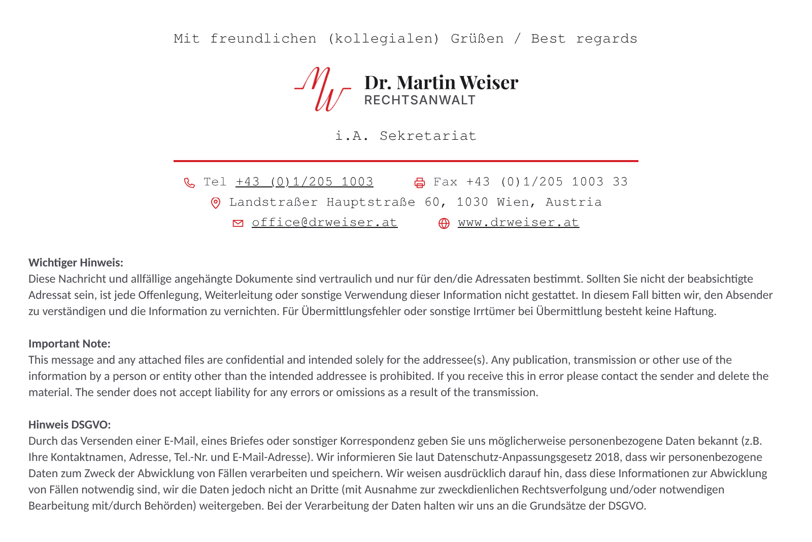
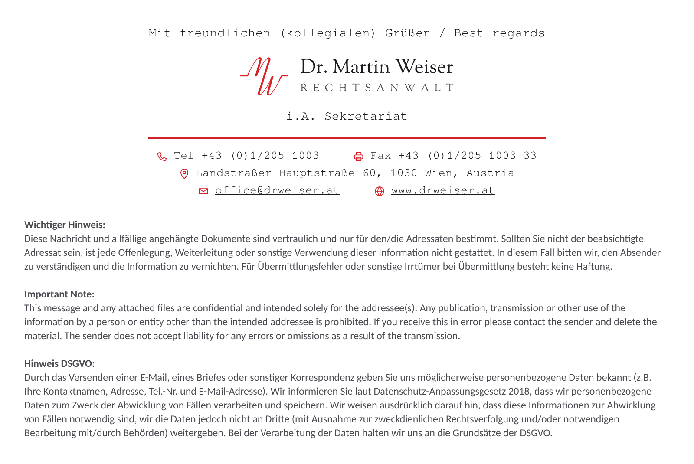
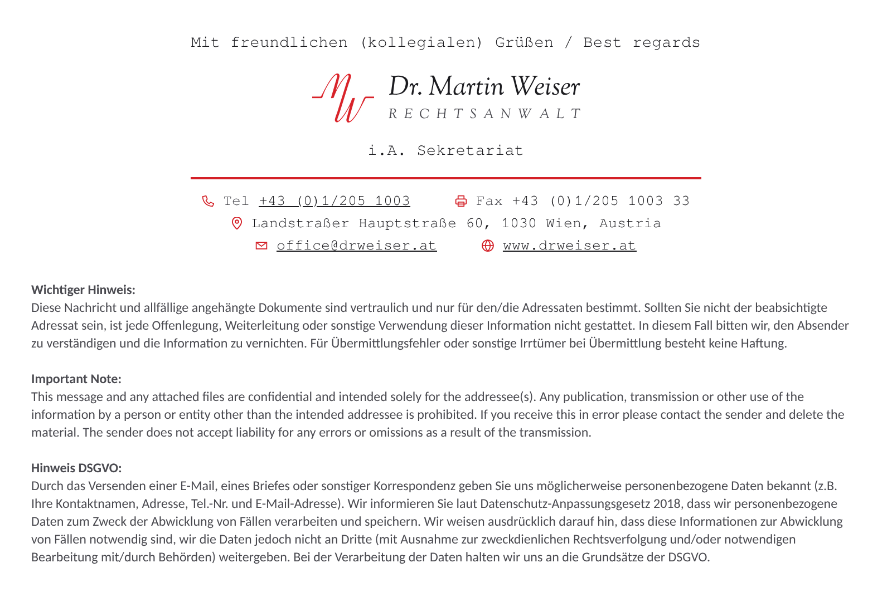

# E-Mail-Signatur – Kanzlei Dr. Martin Weiser

Zentriert, in **Courier New**, mit langem rotem Strich und den Kontakt-Symbolen der Website.
Darunter steht linksbündig der Hinweistext („Wichtiger Hinweis“, „Important Note“, „Hinweis DSGVO“) in **Calibri**, klein und grau.
Die Fassungen unterscheiden sich nur im Logo.

**A – Logo wie auf der Website** (Name in den Website-Schriften, als Bild)

**B – Name in Courier New** (rotes MW-Zeichen, Name als Text)

**C – Name in Calisto MT** (rotes MW-Zeichen, Name als Text)

**D – Name in Calisto MT kursiv** (rotes MW-Zeichen, Name als Text)

**E – Name in Calisto MT, „RECHTSANWALT“ gesperrt** (so lang wie „Dr. Martin Weiser“)

**F – wie E, aber kursiv** (Name und „RECHTSANWALT“ in Calisto MT kursiv, gleich lang)

## Dateien

| Datei | Wofür |
| --- | --- |
| `Signatur-A-Logo-wie-Website.zip` | Fassung A zum Herunterladen |
| `Signatur-B-alles-Courier-New.zip` | Fassung B zum Herunterladen |
| `Signatur-C-Calisto-MT.zip` | Fassung C zum Herunterladen |
| `Signatur-D-Calisto-MT-kursiv.zip` | Fassung D zum Herunterladen |
| `Signatur-E-Calisto-MT-gesperrt.zip` | Fassung E zum Herunterladen |
| `Signatur-F-Calisto-MT-kursiv-gesperrt.zip` | Fassung F zum Herunterladen |
| `A-…/` bis `F-…/` | Inhalt der ZIP-Dateien |

Jede ZIP-Datei enthält:

| Datei | Wofür |
| --- | --- |
| `Kanzlei.htm` | die Signatur für Outlook, braucht den Ordner `bilder` daneben |
| `bilder/` | Logo bzw. MW-Zeichen und Symbole |
| `Kanzlei.txt` | Textfassung für E-Mails im Nur-Text-Format (nur für Plan B nötig) |
| `signatur-komplett.html` | dieselbe Signatur mit eingebauten Bildern, zum Ansehen und für den Mac |

## Einrichten im klassischen Outlook (oben links gibt es „Datei“)

Die Schritte sind für alle Fassungen gleich.
Kopiert wird über Word, weil Outlook aus dem Browser keine Bilder mitnimmt.

1. Die ZIP-Datei der gewünschten Fassung herunterladen.
   Dann mit Rechtsklick → **Alle extrahieren…** → **Extrahieren** entpacken.
2. Im entpackten Ordner mit Rechtsklick auf `Kanzlei.htm` → **Öffnen mit** → **Word** gehen.
   Steht Word nicht in der Liste: **Andere App auswählen** → **Word**.
3. Erscheint oben ein gelber Balken „Geschützte Ansicht“, auf **Bearbeitung aktivieren** klicken.
   Jetzt sollten Logo und Symbole zu sehen sein.
4. **Strg + A** und dann **Strg + C** drücken. Danach Word schließen, ohne zu speichern.
5. In Outlook auf **Datei → Optionen → E-Mail → Signaturen…** gehen.
   Die alte Signatur „Kanzlei“ auswählen und **Löschen**.
   Dann auf **Neu** klicken, „Kanzlei“ eingeben und mit **OK** bestätigen.
6. Ins Feld „Signatur bearbeiten“ klicken, **Strg + V** drücken und auf **Speichern** klicken.
7. Rechts bei **Neue Nachrichten** und **Antworten/Weiterleitungen** jeweils „Kanzlei“ auswählen und mit **OK** bestätigen.
8. Eine Testmail an die eigene Adresse und ans Handy schicken.

**Nur bei Fassung E und F:** Reicht „RECHTSANWALT“ in Word in Schritt 3 nicht genau so weit wie der Name,
die Zeile „R E C H T S A N W A L T“ markieren und **Strg + Umschalt + J** drücken (Ausrichtung „Verteilt“).
Erst danach mit Schritt 4 weitermachen.

## Plan B: Dateien direkt in den Signaturen-Ordner legen

Nur nötig, falls die Bilder auch über Word nicht mitkommen.

1. Outlook schließen.
2. **Windows-Taste + R** drücken, `%APPDATA%\Microsoft\Signatures` eingeben und **OK** klicken.
3. Aus dem entpackten Ordner `Kanzlei.htm`, `Kanzlei.txt` und den Ordner `bilder` hineinkopieren.
   Fragt Windows nach dem Ersetzen, **Ersetzen** wählen.
4. Outlook starten und unter **Datei → Optionen → E-Mail → Signaturen…** „Kanzlei“ als Standard auswählen.

## Neues Outlook (kein „Datei“-Menü)

Den Weg über Word bietet das neue Outlook nicht. Bitte kurz Bescheid geben, dann gibt es eine passende Anleitung.

## Mac (Apple Mail oder Outlook für Mac)

1. `signatur-komplett.html` in Safari öffnen.
2. **Cmd + A** und dann **Cmd + C** drücken.
3. Die Signatur im Signatur-Fenster einfügen:
   - Apple Mail: **Mail → Einstellungen → Signaturen**
   - Outlook für Mac: **Outlook → Einstellungen → Signaturen**
4. In Apple Mail unter dem Signaturfeld das Häkchen bei der Standardschrift entfernen.

## Gut zu wissen

- **Calisto MT** (Fassungen C bis F) wird mit Microsoft Office installiert.
  Wer die Schrift nicht hat, z. B. am iPhone, sieht eine ähnliche Schrift (Book Antiqua, Palatino oder Georgia).
- Bei **Fassung E und F** wird „RECHTSANWALT“ auf die Länge des Namens verteilt.
  Mailprogramme, die das nicht können (z. B. Gmail), zeigen die Zeile etwas kürzer, aber gesperrt.
- Der Hinweistext ist wortgleich übernommen.
  Er steht in Calibri 9 pt in Dunkelgrau, die drei Überschriften sind fett.
- Die Symbole sind die der Website (Telefon, Adresse, E-Mail).
  Für Fax und Website gibt es dort keine eigenen Symbole, deshalb sind Drucker und Globus im selben Stil ergänzt.
- Telefonnummer, E-Mail-Adresse und Website sind verlinkt.
- Die Website-Links führen auf https://drweiser.at ohne „www“, angezeigt wird aber „www.drweiser.at“.
  Das Sicherheitszertifikat der Website gilt nämlich nur für drweiser.at.
- Die Vorschauen entstanden mit Ersatzschriften, die Courier New, Calisto MT und Calibri sehr ähnlich sehen.
  In Outlook erscheinen die echten Schriften.
